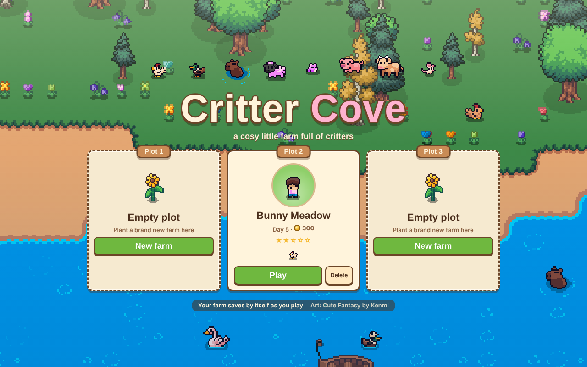
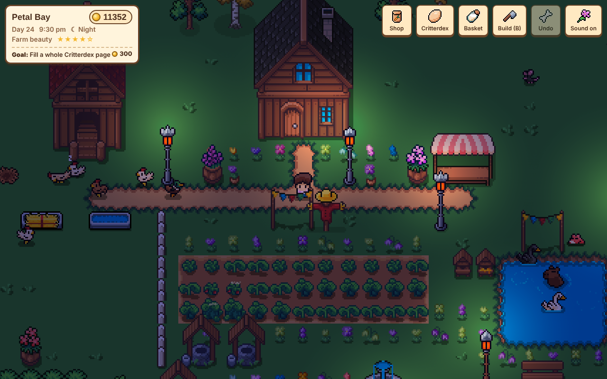

# 🐣 Critter Cove 🌸

A cosy little farm game you play right in your browser. Raise happy animals, grow crops,
adopt wild critters, keep bees, decorate your house and make the prettiest farm on the island.

**▶ Play it:** https://kierbob.github.io/CritterCove/

## Things to do
- 🐔 **Raise animals:** chickens, ducks, geese, sheep, pigs, cows and horses. Feed, water and pat them every day
- 🐣 **Breed every colour:** happy animals have babies, sometimes in rare new colours for your Critterdex
- 🐸 **Adopt wild critters:** pat a frog, mouse, swan or capybara, then win it over with a critter snack
- 🥕 **Farm:** 22 crops from wheat to watermelons. Plant, water, harvest
- 🐝 **Bees and butterflies:** beehives make honey from nearby flowers; butterflies visit pretty farms
- 🎣 **Fish, forage, chop and mine** to earn coins at the market stall
- 🏡 **Decorate:** build mode outside, and furniture for inside your cottage
- 💾 Three save plots, and your farm saves by itself

## Controls
| | |
|---|---|
| Move | WASD / arrow keys, or click where to go |
| Interact | Click animals, crops, trees, rocks, water and buildings |
| Build mode | **B** · Undo with **Ctrl+Z** |
| Pause / settings | **Esc** or the Menu button |
| Zoom | Mouse wheel / pinch |

## Put it online with GitHub Pages
1. Upload everything in this folder to a new **public** repository (the `assets` folder stays empty on GitHub, and that's on purpose).
2. Open **Settings → Pages**, set **Source** to *Deploy from a branch*, branch `main`, folder `/ (root)`, and save.
3. After a minute or two the game is live at `https://YOUR-USERNAME.github.io/REPO-NAME/`.

## Changing the game
The code is in `src/`. `index.html` is the finished game with the art built in.
To rebuild it after a change, put the Cute Fantasy pack in `assets/` and run `python build.py`
(needs Python 3 and Pillow: `pip install pillow`).

## Credits
- Art: [Cute Fantasy](https://kenmi-art.itch.io/cute-fantasy-rpg) by Kenmi, used under its premium licence.
  The pack's files aren't included in this repository, only the finished game.
- Made with ❤️ for friends.
